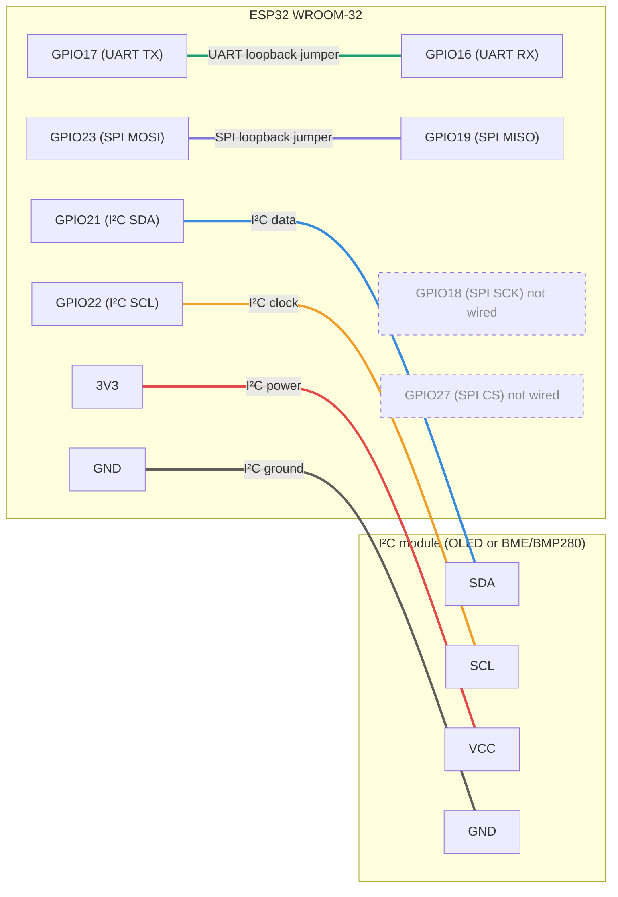

# ESP32_Wired_Communication

# ESP32 Interface Verification: UART, I²C and SPI

Verification of the three wired interfaces on an ESP32 (WROOM-32) board using the Arduino IDE 2.3.8, with the Serial Monitor at 115200 baud (COM4).

## 1. Pin table

| Signal | GPIO used |
|---|---|
| UART TX | 17 |
| UART RX | 16 |
| I²C SDA | 21 |
| I²C SCL | 22 |
| SPI SCK | 18 |
| SPI MOSI | 23 |
| SPI MISO | 19 |
| SPI CS | 27 |

None of these are strapping pins (0, 2, 5, 12, 15), flash pins (6–11) or input-only pins (34–39), and every signal has its own pin.

## 2. Wiring diagram



| Connection | From | To |
|---|---|---|
| UART loopback jumper | GPIO17 (TX) | GPIO16 (RX) |
| SPI loopback jumper | GPIO23 (MOSI) | GPIO19 (MISO) |
| I²C data | GPIO21 (SDA) | Module SDA |
| I²C clock | GPIO22 (SCL) | Module SCL |
| I²C power | 3V3 | Module VCC |
| I²C ground | GND | Module GND |

GPIO18 (SCK) and GPIO27 (CS) are assigned in the SPI sketch but are not wired, because the SPI test is a loopback.

## 3. Serial Monitor output

### UART with jumper


The ESP32 prints `PING` once per second.


### UART without jumper
No `PING` appears, because nothing is connected between TX and RX.

### I²C with module


The scanner found one device at address `0x3C`.


### I²C without module (4 wires removed)
The scanner printed `No I2C devices found`.


### SPI with jumper


Every line shows `Sent 0xA5, received 0xA5`.


### SPI without jumper
Every line shows `Sent 0xA5, received 0x00`.


### Sketch at 9600, monitor at 115200
Garbled characters (unreadable squares) appear instead of `PING`.


### Sketch at 9600, monitor at 9600
Clean `PING` lines appear once per second.


## 4. Expected vs observed

| Test | Expected | Observed |
|---|---|---|
| UART with jumper | `PING` printed once per second | `PING` printed once per second |
| UART without jumper | Nothing received; the monitor stays blank | No `PING` received |
| I²C with module | `Found device at 0x3C` (OLED) | `Found device at 0x3C` |
| I²C without module | `No I2C devices found` | `No I2C devices found` |
| SPI with jumper | `Sent 0xA5, received 0xA5` | `Sent 0xA5, received 0xA5` |
| SPI without jumper | A value other than `0xA5` (often `0x00` or `0xFF`) | `Sent 0xA5, received 0x00` |
| Sketch at 9600, monitor at 115200 | Garbled characters | Garbled characters (unreadable squares) |
| Sketch at 9600, monitor at 9600 | Clean `PING` | Clean `PING` once per second |

## 5. Questions

**1. Why does UART need both sides to use the same baud rate, while SPI uses a clock line?**
```UART has no clock wire, so the receiver times each bit with its own internal timer, and that only lines up with the sender if both use the same baud rate. SPI sends a clock signal along with the data, so the receiver reads each bit on the clock edges and the speed doesn't need to be agreed in advance.```

**2. Why can two devices with the same address not share one I²C bus?**
```Every I²C transaction starts with the controller sending an address, and both devices with that address would answer at the same time on the shared SDA line. Their signals would collide, so the controller could not tell which device replied or talk to just one of them.```

**3. Why is CS set HIGH between SPI transfers?**
```CS is active-low, so setting it HIGH tells the device the transfer is finished and it should stop listening and reset its bit counter. It also deselects the device so it ignores the shared clock and data lines while the controller talks to other devices.```

## Notes

- The `Serial.begin(9600)` change was made only for the baud-rate experiment. The committed `uart_loopback.ino` uses `Serial.begin(115200)`.
- The burst of text at boot (`ets Jul 29 2019...`, `rst:0x1...`) is the ESP32 bootloader message, which is printed at 115200 baud.
